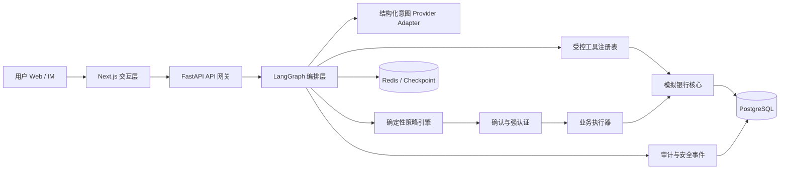

# 第一版系统架构

## 架构原则

1. 大模型只负责自然语言理解、结构化参数提取和受限计划生成。
2. 权限等级由确定性策略引擎计算，不允许模型自行放行交易。
3. 写操作先生成草案，确认或认证后由后端执行器提交。
4. 所有业务结果均来自工具和核心业务接口回执。
5. 关键步骤写入结构化审计事件，支持暂停、恢复和追踪。

## 逻辑架构



## 已实现的受限执行链

```text
理解意图
  → 参数补全/消歧
  → 生成白名单 DAG
  → DAG 依赖/环/工具校验并计算计划摘要
  → 业务预检查
  → 创建操作草案
  → 策略引擎判级
      ├─ GREEN  → 执行查询
      ├─ YELLOW → 等待显式确认
      └─ RED    → 等待确认与强认证
  → 幂等业务执行
  → 验证业务回执
  → 审计归档
```

Agent 会话、运行、步骤和人工接管记录均保存在 PostgreSQL。等待消歧、确认或验证码时，请求可以结束；后续通过同一 `run_id` 恢复。恢复前必须重新校验 DAG 摘要，不能依赖浏览器内存继续执行。

## 部署边界

- `web`：仅负责交互展示，不持有数据库凭据或执行权限。
- `api`：提供身份上下文、业务接口和 Agent 流程入口。
- `postgres`：保存账户、账单、策略决策、认证挑战、执行回执及审计记录。
- `redis`：后续保存分布式限流状态和 Agent 短期执行状态。
- LLM：只输出结构化意图和槽位，不直接接触银行工具、账户数据库或执行器。
- 模型适配器：只输出结构化意图与槽位，不接收资金执行工具；服务端规划器决定工具和依赖。

## 后续阶段

- 第二阶段（已完成）：模拟银行模型、迁移、种子数据和确定性业务接口。
- 第三阶段（已完成）：权限策略、确认、认证、幂等、审计和熔断。
- 第四阶段（已完成）：LangGraph 规划图、持久化暂停恢复、上下文和人工接管。
- 第五阶段（已完成）：账单、订阅和转账的完整交互工作台。
- 第六阶段（已完成）：LLM 结构化理解、动态补槽、卡片管理、订阅取消和理财推荐。
