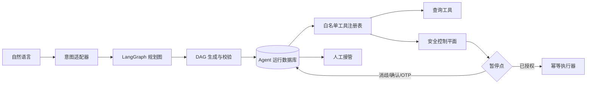
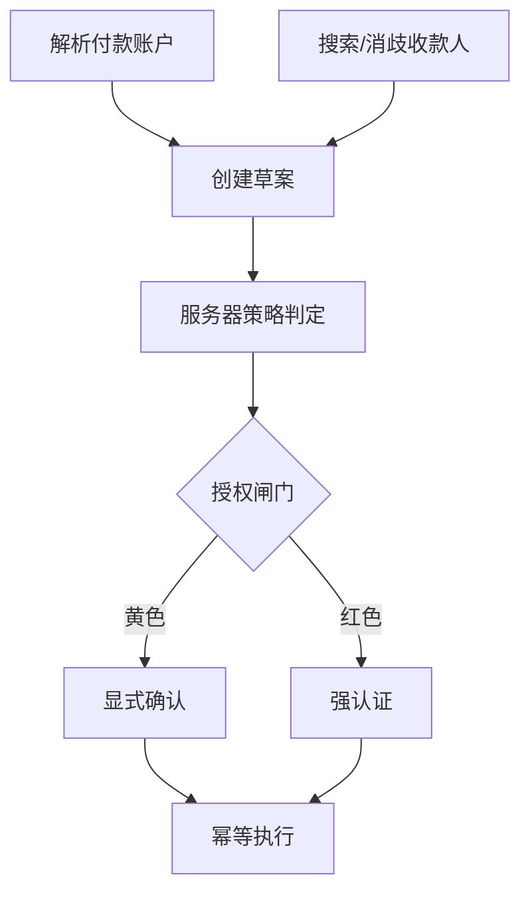

# 第四阶段：Agent 编排与人工接管

## 阶段成果

第四阶段在安全控制平面之外增加自然语言 Agent。系统当前覆盖余额查询、账单分析、订阅查询和安全转账四类意图，并能在收款人消歧、黄色确认、红色强认证处跨请求暂停和恢复。

核心原则是“模型提议、服务器规划、策略授权、核心执行”：模型永远不决定权限等级，也不会直接获得任意工具执行权。

## 技术架构

LangGraph 规划图包含三个节点：`understand_intent → build_dag → validate_dag`。规划结果随后由数据库运行时执行，因此进程重启不会丢失等待中的业务任务。

## 模型适配器

### 默认适配器

默认 `AGENT_MODEL_PROVIDER=deterministic`，使用可测试的中文规则提取意图与槽位，不需要网络或模型密钥，适合答辩现场稳定演示。

### OpenAI Responses 适配器

配置 `AGENT_MODEL_PROVIDER=openai`、`OPENAI_API_KEY` 和 `OPENAI_MODEL` 后，可启用 Responses API。适配器使用 JSON Schema Structured Outputs，只允许返回：

- `intent`
- `confidence`
- `slots`
- `missing_slots`

模型不会看到银行工具定义，也不能输出工具名。传给外部模型的会话记忆会移除内部账户和收款人 ID；疑似提示注入文本在调用外部模型之前切换到本地适配器并转人工。

## 白名单工具

注册表当前只有 10 个工具：

| 工具 | 风险上限 | 作用 |
| --- | --- | --- |
| accounts.list | 绿色 | 查询账户余额 |
| bill.summary | 绿色 | 计算月度账单 |
| subscriptions.list | 绿色 | 查询活跃订阅 |
| payees.search | 绿色 | 搜索收款人 |
| transfer.draft.create | 黄色 | 创建转账草案 |
| transfer.policy.evaluate | 黄色 | 服务器判级 |
| transfer.confirm | 黄色 | 记录明确确认 |
| auth.challenge.create | 红色 | 创建强认证挑战 |
| auth.challenge.verify | 红色 | 验证强认证挑战 |
| transfer.execute | 红色 | 幂等执行资金操作 |

DAG 中出现未注册工具、重复节点、未知依赖或环都会被拒绝。计划以规范 JSON 计算 SHA-256 摘要，每次恢复前重新验证。

## 转账 DAG

用户说“给小王转 300 元”时，两个“小王”会让运行停在 `waiting_clarification`。选择后进入 `waiting_confirmation`；确认才会执行。1200 元则进入 `waiting_auth`，正确 OTP 后才能执行。

## 持久化状态

| 表 | 用途 |
| --- | --- |
| agent_conversations | 渠道、会话状态和最少化上下文记忆 |
| agent_runs | 原始请求、意图、DAG、摘要、状态、待办和结果 |
| agent_steps | 每个节点的脱敏输入、输出、状态和时间 |
| agent_handoffs | 人工接管原因、恢复状态和处理结论 |

会话记忆支持有限的省略表达。例如第一笔任务解析出“妈妈”为刘秀兰后，同一会话中的“再给她转 50 元”可以复用上次收款人，但仍需重新创建草案并重新判级。

## API

| 方法与路径 | 能力 |
| --- | --- |
| GET /api/v1/agent/tools | 查看白名单工具 |
| POST /api/v1/agent/runs | 创建并推进一次 Agent 运行 |
| GET /api/v1/agent/runs/{id} | 查看 DAG、步骤、待办和结果 |
| GET /api/v1/agent/runs | 按会话查询运行历史 |
| POST /api/v1/agent/runs/{id}/resume | 提交消歧、确认或 OTP 并恢复 |
| POST /api/v1/agent/runs/{id}/handoff | 主动转交人工 |
| POST /api/v1/agent/runs/{id}/human-resolution | 人工恢复、取消或完成任务 |
| GET /api/v1/agent/conversations/{id} | 查看会话上下文 |

## 人工接管

以下情况会进入 `human_review`：

- 意图不在支持白名单；
- 原始请求或补充信息包含指令覆盖、权限绕过或秘密提取信号；
- 用户主动要求人工处理。

人工可以恢复原暂停点、取消任务，或只给出人工处理结果。人工完成不会伪造银行交易回执，也不会绕过资金执行器。

## 验收

- 31 项自动化测试通过；
- 余额、账单、订阅三类绿色意图自动完成；
- 同名收款人跨请求消歧后进入黄色确认；
- 红色转账跨请求 OTP 验证后执行；
- 相同会话可以识别“再给她转”；
- 原始请求和补充信息的注入信号均会转人工；
- 未注册工具、环形 DAG 和计划篡改可被检测；
- 第三个迁移升级、单独回退及完整回退通过；
- SQLite 查询计划确认会话运行索引被使用；
- 真实 HTTP 演示链路和审计哈希链通过。

## 已知边界

- 当前确定性适配器针对竞赛演示语料，不是完整中文 NLU；
- OpenAI 适配器已实现但未在本地配置真实 API 密钥，因此未执行线上模型调用；
- 当前运行状态保存在业务表中，没有启用 LangGraph 官方 Postgres checkpointer；
- 前端仍待下一阶段接入 Agent API 和暂停交互组件。
